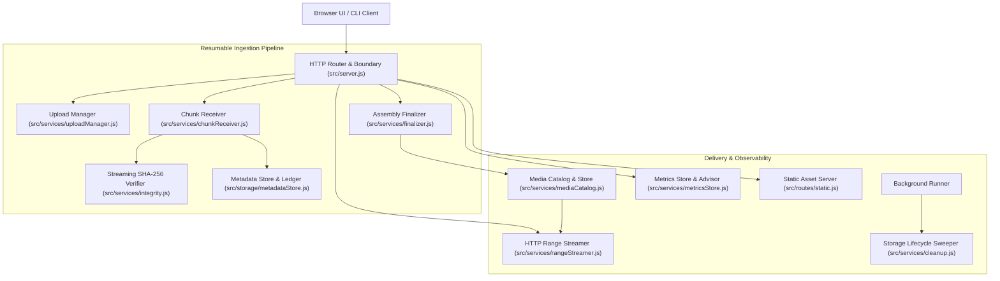
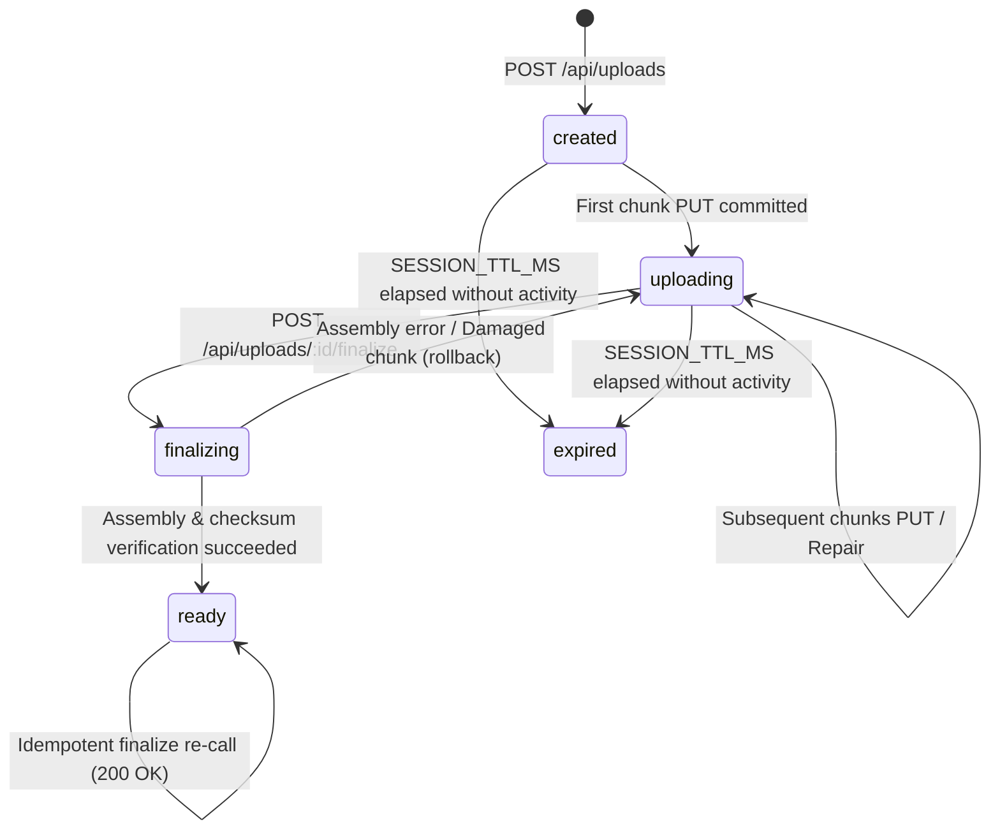

# Scalable File Upload & Streaming Media Service

A resilient, local-first chunked file upload and HTTP Range streaming media service written in **pure Node.js using only standard built-in core modules** (`http`, `fs`, `stream`, `crypto`, `path`, `url`, `os`, `node:test`, `node:assert`). It has zero third-party npm dependencies.

The core engineering principle is the **"Proof-of-Progress" Transfer Ledger**:
- The server maintains a durable, append-only metadata ledger recording verified byte ranges.
- Progress represents only bytes durably written and SHA-256 verified—never uncommitted in-flight socket buffers.
- Transfer interruptions leave verified chunks intact on disk; clients resume by querying missing ranges.
- Sequential streaming finalizer verifies individual chunk hashes and computes the whole-file digest concurrently.
- Instant HTTP Range streaming (`200 OK`, `206 Partial Content`, `416 Range Not Satisfiable`) allows media seeking with zero full-file buffering.

---

## Requirements & Quick Start

### Requirements
- **Node.js**: `v20.0.0` or higher (tested on Node.js LTS `v20.20.2`).
- **Dependencies**: None. Zero `node_modules` required.
- **Client Environment**: Modern web browser with Web Cryptography API (`crypto.subtle`) support.
  > [!NOTE]
  > `crypto.subtle` requires a [Secure Context](https://developer.mozilla.org/en-US/docs/Web/Security/Secure_Contexts). It is enabled by default on `http://127.0.0.1:3000/` and `http://localhost:3000/`.

### Quick Start
```bash
# 1. Clone repository and navigate to service directory
cd file-stream-service

# 2. Start server in development mode (with file watching)
npm run dev
# Or for standard production start:
# npm start

# 3. Open the browser interface
open http://127.0.0.1:3000/
```

---

## System Architecture



### Request Flow in Prose
1. **Creation**: The client initiates an upload session via `POST /api/uploads`. The `uploadManager` validates the file name, declared size, and MIME type, establishes the directory structure under `storage/uploads/<id>`, and creates `metadata.json` with state `created`.
2. **Chunk Ingestion**: The client slices the file into chunks and sends them via `PUT /api/uploads/:id/chunks/:index`. The `chunkReceiver` pipes the request body into a temporary file (`storage/temp/<id>-<index>-<rand>.part`) while hashing with `crypto.createHash('sha256')`. Once the stream completes, byte count and checksum are validated.
3. **Ledger Commit**: Under a serialized per-upload lock (`updateMetadata`), the verified temporary chunk is atomically renamed to `storage/uploads/<id>/chunks/<index>.part`, and `metadata.json` is updated with the committed byte range and checksum.
4. **Finalization & Assembly**: The client triggers completion via `POST /api/uploads/:id/finalize`. The `finalizer` verifies complete range coverage (zero gaps or overlaps), transitions state to `finalizing`, and streams each chunk sequentially into a single media file (`storage/temp/<id>-final-<rand>.tmp`). Concurrently, it re-verifies each chunk hash and computes the whole-file SHA-256 digest. Upon verification, the temp file is atomically renamed to `storage/media/<mediaId>.<ext>`, and `storage/media/<mediaId>.json` is written.
5. **Streaming Playback**: The browser media player requests byte ranges (`Range: bytes=0-`) via `GET /api/media/:mediaId`. The `rangeStreamer` validates bounds, emits `206 Partial Content` with `Content-Range`, and pipes a backpressured slice directly from disk without reading the whole file into RAM.

---

## Storage Layout

All files are managed locally within the configured `storageRoot` directory (defaults to `file-stream-service/storage`):

```text
storage/
├── uploads/
│   └── <uploadId>/
│       ├── metadata.json       # Durable session ledger (state, chunk ranges, hashes)
│       ├── metrics.json        # Persisted client and server timing metrics
│       └── chunks/
│           ├── 000000.part     # Committed chunk 0
│           ├── 000001.part     # Committed chunk 1
│           └── 000002.part     # Committed chunk 2
├── temp/
│   ├── <id>-<idx>-<hex>.part   # In-flight uncommitted chunk stream
│   └── <id>-final-<hex>.tmp    # In-progress assembled media stream
└── media/
    ├── <mediaId>.<ext>         # Final assembled media file
    └── <mediaId>.json          # Immutable media metadata record
```

---

## State Machine

Upload sessions transition through well-defined lifecycle states governed by durable ledger updates and mutex locks:



- **`created`**: Session allocated. No chunks committed yet.
- **`uploading`**: One or more chunks committed. Chunks can arrive in any order or concurrency.
- **`finalizing`**: Assembly underway. New chunk PUT requests return `409 Conflict` (`FINALIZE_IN_PROGRESS`). If assembly fails (e.g. damaged chunk on disk), state automatically reverts to `uploading` with `lastFinalizeError` recorded.
- **`ready`**: Media published. Upload session is immutable. Subsequent finalize calls return `200 OK` idempotently.
- **`expired`**: Session exceeded `SESSION_TTL_MS` without completion. Chunks and temp files are reclaimed by `cleanup.js`.

---

## Mathematical Model & Calculations

All byte offsets, range bounds, and counters use safe integer arithmetic.

### 1. Chunk Count & Range Math
For total file size $S$ bytes and configured chunk size $C$ bytes:
$$\text{Total Chunks } N = \lceil S / C \rceil$$

For zero-based chunk index $i \in [0, N-1]$:
$$\text{start}(i) = i \times C$$
$$\text{end}(i) = \min(\text{start}(i) + C - 1, S - 1)$$
$$\text{length}(i) = \text{end}(i) - \text{start}(i) + 1$$

*Worked Example:*
For $S = 7,340,032$ bytes (7.0 MiB) and $C = 1,048,576$ bytes (1.0 MiB):
- $N = \lceil 7,340,032 / 1,048,576 \rceil = 7$ chunks.
- Chunk 0: `bytes 0-1048575/7340032` (Length: 1,048,576 bytes).
- Chunk 6: `bytes 6291456-7340031/7340032` (Length: 1,048,576 bytes).
- If $S = 7,500,000$ bytes, Chunk 7 length is $7,500,000 - 7,340,032 = 159,968$ bytes.

### 2. Client Slicing vs. HTTP Content-Range (Inclusive vs. Exclusive)
HTTP `Content-Range` headers specify **inclusive** byte bounds: `bytes 0-1048575` contains $1048575 - 0 + 1 = 1,048,576$ bytes.
The JavaScript `Blob.prototype.slice(start, end)` method uses **exclusive** end indices.
Therefore, client-side slicing must compute:
$$\text{sliceEnd} = \text{end} + 1$$
$$\text{slice} = \text{blob.slice}(\text{start}, \text{sliceEnd})$$
*(Omitting this $+1$ drops exactly 1 byte per chunk, corrupting the transfer).*

### 3. Progress Percentage
Progress strictly reflects verified bytes committed to the ledger:
$$\text{progressPercent} = \min\left(100, \left\lfloor \frac{\text{committedBytes}}{\text{totalBytes}} \times 10000 \right\rfloor \div 100 \right)$$
In-flight or unacknowledged socket bytes are never counted.

### 4. Throughput & ETA
- **Client-Observed Throughput**:
  $$\text{MiB/s} = \frac{\text{bytesTransferred} \times 1000}{\text{elapsedMs} \times 1,048,576}$$
- **Server-Observed Active Throughput**:
  $$\text{activeBytesPerSecond} = \frac{\text{committedBytes} \times 1000}{\text{activeMs}}$$
  Where $\text{activeMs}$ represents the union of all active chunk transfer intervals (merging overlapping concurrency and gaps $< 1000\text{ms}$).
- **Rough Transfer-Time Estimate (ETA)**:
  $$\text{estimatedSeconds} = \left\lfloor \frac{\text{remainingBytes}}{\text{recentBytesPerSecond}} \right\rfloor$$
  ETA is only displayed after at least 3 chunk samples have been recorded.

### 5. Resend Efficiency Score
Measures transfer waste caused by duplicate resends or repairs:
$$\text{resendEfficiency} = \left\lfloor \frac{\text{bytesResent}}{\text{totalBytes}} \times 10000 \right\rfloor \div 10000$$
A clean upload achieves `0.0000`.

### 6. Bounded Memory Model
Application memory usage is decoupled from file size:
$$\text{Max Heap Overhead} \approx \text{concurrency} \times (\text{chunkSize} + 64\text{ KiB Stream Buffer}) + \text{Ledger Metadata}$$
A 100 MiB or 2 GiB upload executed at concurrency 2 with 1 MiB chunks requires $< 15\text{ MiB}$ of heap memory.

---

## HTTP API Reference

All error responses adhere to the standard schema:
```json
{
  "error": {
    "code": "ERROR_CODE",
    "message": "Human-readable explanation",
    "details": null
  }
}
```

### Endpoints Table

| Method | Route | Purpose | Success Code | Error Codes |
|---|---|---|---|---|
| `POST` | `/api/uploads` | Initialize resumable upload session | `201 Created` | `400 BAD_REQUEST`, `409 CONFLICT`, `413 PAYLOAD_TOO_LARGE`, `415 UNSUPPORTED_MEDIA_TYPE` |
| `GET` | `/api/uploads/:id` | Query session ledger and missing ranges | `200 OK` | `400 BAD_REQUEST`, `404 NOT_FOUND`, `500 METADATA_CORRUPT` |
| `PUT` | `/api/uploads/:id/chunks/:index` | Stream chunk binary with SHA-256 digest | `201 Created`, `200 OK` (Duplicate) | `400 BAD_REQUEST`, `404 NOT_FOUND`, `409 CHUNK_CONFLICT`, `409 SESSION_EXPIRED`, `413 PAYLOAD_TOO_LARGE`, `422 CHECKSUM_MISMATCH`, `507 INSUFFICIENT_STORAGE` |
| `POST` | `/api/uploads/:id/finalize` | Verify coverage, assemble media file | `200 OK` | `400 BAD_REQUEST`, `404 NOT_FOUND`, `409 INCOMPLETE_UPLOAD`, `409 LEDGER_INVALID`, `409 FINALIZE_IN_PROGRESS`, `409 CHUNKS_DAMAGED`, `422 CHUNK_CORRUPT`, `422 FILE_CHECKSUM_MISMATCH`, `507 INSUFFICIENT_STORAGE` |
| `GET` | `/api/media` | List published media items | `200 OK` | `500 INTERNAL_SERVER_ERROR` |
| `GET` | `/api/media/:id` | Stream full file or HTTP Byte Range | `200 OK`, `206 Partial Content`, `304 Not Modified` | `400 BAD_REQUEST`, `404 NOT_FOUND`, `416 RANGE_NOT_SATISFIABLE` |
| `HEAD` | `/api/media/:id` | Inspect headers without body | `200 OK`, `304 Not Modified` | `400 BAD_REQUEST`, `404 NOT_FOUND` |
| `GET` | `/api/metrics/:id` | Get upload timing & throughput report | `200 OK` | `400 BAD_REQUEST`, `404 NOT_FOUND` |
| `GET` | `/api/recommendation/chunk-size` | Adaptive chunk size recommendation | `200 OK` | `500 INTERNAL_SERVER_ERROR` |
| `GET` | `/api/stats` | Process memory, CPU, and upload counts | `200 OK` | `500 INTERNAL_SERVER_ERROR` |
| `GET` | `/health` | Server uptime and health check | `200 OK` | `500 INTERNAL_SERVER_ERROR` |

---

### Complete Error Code Registry

| Error Code | HTTP Status | Origin & Condition |
|---|---|---|
| `BAD_REQUEST` | 400 | Malformed JSON body, invalid query parameter, negative index, or missing parameters |
| `NOT_FOUND` | 404 | Upload ID or Media ID does not exist |
| `METHOD_NOT_ALLOWED` | 405 | HTTP verb not permitted on route (sets `Allow` header) |
| `CONFLICT` | 409 | Concurrent upload capacity exceeded (`MAX_CONCURRENT_UPLOADS`) |
| `SESSION_EXPIRED` | 409 | Upload session exceeded TTL or was expired by cleanup |
| `FINALIZE_IN_PROGRESS` | 409 | Concurrent finalization already underway for this upload ID |
| `INCOMPLETE_UPLOAD` | 409 | Finalization requested before all byte ranges are committed (returns `missingRanges`) |
| `LEDGER_INVALID` | 409 | Chunk ledger contains duplicate indices, overlapping ranges, or gaps |
| `CHUNKS_DAMAGED` | 409 | Assembly found chunk files missing or truncated on disk (reverts to `uploading`) |
| `CHUNK_CONFLICT` | 409 | Chunk PUT received for already committed index but with differing SHA-256 checksum |
| `PAYLOAD_TOO_LARGE` | 413 | Request entity exceeds `maxUploadBytes`, `maxChunkBytes`, or `maxJsonBodyBytes` |
| `UNSUPPORTED_MEDIA_TYPE` | 415 | File MIME type not in configured `allowedContentTypes` |
| `RANGE_NOT_SATISFIABLE` | 416 | Requested Range header start exceeds total file size (sets `Content-Range: bytes */size`) |
| `UNPROCESSABLE_ENTITY` | 422 | `Content-Range` math mismatch or invalid checksum header format |
| `CHECKSUM_MISMATCH` | 422 | Chunk body SHA-256 digest does not match `X-Chunk-SHA256` header |
| `CHUNK_CORRUPT` | 422 | Disk bit-rot detected during assembly; chunk is evicted from ledger for client re-upload |
| `FILE_CHECKSUM_MISMATCH` | 422 | Assembled whole-file SHA-256 does not match client-declared expected hash |
| `METADATA_CORRUPT` | 500 | Metadata JSON ledger file corrupted on disk (omits system paths from response) |
| `ASSEMBLY_FAILED` | 500 | Pipeline error during chunk stream concatenation |
| `INSUFFICIENT_STORAGE` | 507 | Server disk is full (`ENOSPC` or `EDQUOT`); cleans up temp files and preserves state |

---

## Integrity, Idempotency & Recovery Flows

### 1. Fast-Path Idempotent Retries
When a client re-sends a chunk PUT for index $i$:
1. The server acquires the per-upload lock and inspects the ledger.
2. If index $i$ is already committed and has the **exact same SHA-256**:
   - The server skips writing to disk and immediately returns `200 OK` with `{ "duplicate": true, "index": i }`.
   - `bytesResent` is incremented in metrics; `committedBytes` is not double-counted.
3. If index $i$ is committed but has a **different SHA-256**:
   - The request is rejected with `409 Conflict` (`CHUNK_CONFLICT`), leaving the existing chunk intact.

### 2. Damaged-Chunk Repair Flow
If a committed chunk file is accidentally deleted or truncated on disk:
1. `GET /api/uploads/:id?verify=true` runs non-destructive `stat` checks and flags damaged chunks in `problems[]`.
2. When the client PUTs the replacement chunk, the server detects the missing/truncated file under lock.
3. The server overwrites the chunk on disk, verifies the hash, and returns `201 Created` with `{ "repaired": true, "index": i }`.

### 3. Resume Protocol
Clients never assume progress; they query server state:
1. Client fetches `GET /api/uploads/:id`.
2. Server returns `{ state, committedRanges, missingRanges, missingChunks }`.
3. Client worker pool schedules PUT requests **only** for entries in `missingChunks`.

---

## HTTP Range Streaming & Seeking

The Range streamer implements single-range streaming compliant with RFC 9110:

| Request Header | Status Code | Response Headers | Stream Behavior |
|---|---|---|---|
| None | `200 OK` | `Accept-Ranges: bytes`, `Content-Length`, `ETag` | Streams entire media file from start to finish |
| Non-byte unit (`items=0-5`) | `200 OK` | `Accept-Ranges: bytes`, `Content-Length` | Ignores unsupported units; returns full file |
| Multi-range (`bytes=0-10,20-30`) | `200 OK` | `Accept-Ranges: bytes`, `Content-Length` | Multi-range not supported; returns full file |
| Malformed (`bytes=5-2`, `bytes=-`) | `400 Bad Request` | `Content-Type: application/json` | Rejects with `BAD_REQUEST` error |
| Unsatisfiable (`bytes=8000000-`) | `416 Range Not Satisfiable` | `Content-Range: bytes */size` | Empty body; informs client of real file size |
| Valid Range (`bytes=0-1023`) | `206 Partial Content` | `Content-Range: bytes 0-1023/size`, `Content-Length: 1024` | Streams exact slice `[0, 1023]` (1024 bytes) |
| Open-ended (`bytes=1024-`) | `206 Partial Content` | `Content-Range: bytes 1024-(size-1)/size` | Streams from byte 1024 to end of file |
| Suffix range (`bytes=-500`) | `206 Partial Content` | `Content-Range: bytes (size-500)-(size-1)/size` | Streams final 500 bytes of file |

### Precondition Evaluation Order
1. **`If-None-Match`**: Compared against quoted strong ETag (`"checksum"`). If matched $\rightarrow$ `304 Not Modified`.
2. **`If-Modified-Since`**: Compared against file `mtime`. If not modified $\rightarrow$ `304 Not Modified`.
3. **`If-Range`**: Only exact quoted strong ETag or exact Last-Modified string matches. If matched $\rightarrow$ serves `206 Partial Content`. If mismatched $\rightarrow$ ignores Range header and serves full file `200 OK`.

---

## Configuration & Environment Variables

All settings are configured via environment variables and loaded by [`src/config.js`](file:///Users/rohithrao/sem%205%20projects/FSWD%20CBP/file-stream-service/src/config.js). Any environment variable starting with `_` is discarded for security.

| Variable | Default Value | Description |
|---|---|---|
| `HOST` | `127.0.0.1` | Network interface to bind HTTP listener |
| `PORT` | `3000` | Port number (1–65535) |
| `STORAGE_ROOT` | `<projectRoot>/storage` | Absolute or relative root directory for uploads, temp, and media |
| `MAX_JSON_BODY_BYTES` | `65536` (64 KiB) | Maximum allowed size for JSON request bodies |
| `MAX_UPLOAD_BYTES` | `2147483648` (2 GiB) | Maximum total file size allowed for an upload session |
| `MIN_CHUNK_BYTES` | `65536` (64 KiB) | Minimum allowed chunk size |
| `DEFAULT_CHUNK_BYTES` | `1048576` (1 MiB) | Default chunk size when not specified in upload creation |
| `MAX_CHUNK_BYTES` | `16777216` (16 MiB) | Maximum allowed chunk size |
| `MAX_CONCURRENT_UPLOADS` | `10` | Maximum simultaneous active upload sessions |
| `MAX_FILENAME_LENGTH` | `255` | Maximum character length for uploaded filenames |
| `REQUEST_TIMEOUT_MS` | `120000` (120 s) | Inactive request socket timeout |
| `HEADERS_TIMEOUT_MS` | `60000` (60 s) | Timeout for receiving complete HTTP request headers |
| `KEEP_ALIVE_TIMEOUT_MS` | `5000` (5 s) | Keep-Alive idle connection timeout |
| `SESSION_TTL_MS` | `86400000` (24 h) | Inactivity TTL before unfinalized upload sessions expire |
| `TEMP_FILE_TTL_MS` | `3600000` (1 h) | Age threshold for deleting orphaned temporary files in `storage/temp` |
| `ORPHAN_GRACE_MS` | `3600000` (1 h) | Grace period before uncommitted chunks or media files are reaped |
| `CLEANUP_INTERVAL_MS` | `600000` (10 min) | Periodic background sweep interval |
| `CLEANUP_ENABLED` | `true` | Set to `false` or `0` to disable automatic background cleanup sweeps |

---

## Security, Hygiene & Path Safety

- **Path Traversal Protection**: All filesystem access is validated against `storageRoot` using `assertInsideStorageRoot()`. User-provided paths with `..`, slashes, null bytes, or URL-encoded escapes are rejected with `400 Bad Request` or `404 Not Found`.
- **Content-Security-Policy (CSP)**: Strict headers disallow inline scripts and styles:
  ```text
  default-src 'self'; script-src 'self'; style-src 'self'; media-src 'self' blob:; object-src 'none'; frame-ancestors 'none';
  ```
- **Log Hygiene**: Request log paths are strictly normalized. Raw file paths, filenames, and authentication data are never emitted to logs.
- **Disk Full Protection (507)**: If disk space is exhausted (`ENOSPC` or `EDQUOT`), the server aborts the stream, removes temporary files, returns `507 Insufficient Storage`, and preserves metadata state so the upload can resume once disk space is restored.

---

## Automated Benchmarks

Benchmarks are executed via `node scripts/benchmark.js` across a full matrix of chunk sizes and concurrency levels using isolated child processes and seeded 100 MiB files:

| Chunk Size | Concurrency | Elapsed (median ms) | Throughput (median MiB/s) | Min-Max MiB/s | Assembly (ms) | Server Peak RSS (MiB) | Server CPU (ms) | Attempts/Retries |
|---|---|---|---|---|---|---|---|---|
| 256 KiB    | 1           | 4165                | 24.01                     | 23.65 - 24.22 | 307           | 105                   | 1719            | 400 / 0          |
| 256 KiB    | 2           | 3422                | 29.22                     | 29.01 - 29.38 | 309           | 106                   | 1798            | 400 / 0          |
| 256 KiB    | 4           | 3174                | 31.51                     | 31.22 - 31.54 | 307           | 109                   | 1796            | 400 / 0          |
| 256 KiB    | 8           | 3110                | 32.15                     | 31.66 - 32.24 | 306           | 107                   | 1793            | 400 / 0          |
| 1 MiB      | 1           | 1430                | 69.93                     | 69.78 - 70.37 | 217           | 78                    | 836             | 100 / 0          |
| 1 MiB      | 2           | 1087                | 92.00                     | 88.89 - 94.52 | 225           | 78                    | 881             | 100 / 0          |
| 1 MiB      | 4           | 1026                | 97.47                     | 94.97 - 97.56 | 226           | 97                    | 902             | 100 / 0          |
| 1 MiB      | 8           | 998                 | 100.20                    | 98.62 - 100.30 | 220           | 98                    | 877             | 100 / 0          |
| 4 MiB      | 1           | 790                 | 126.58                    | 124.07 - 131.23 | 199           | 87                    | 682             | 25 / 0           |
| 4 MiB      | 2           | 605                 | 165.29                    | 161.55 - 167.79 | 209           | 87                    | 696             | 25 / 0           |
| 4 MiB      | 4           | 569                 | 175.75                    | 172.71 - 176.68 | 215           | 87                    | 692             | 25 / 0           |
| 4 MiB      | 8           | 556                 | 179.86                    | 177.94 - 179.86 | 210           | 87                    | 693             | 25 / 0           |
| 8 MiB      | 1           | 694                 | 144.09                    | 139.47 - 144.30 | 202           | 91                    | 655             | 13 / 0           |
| 8 MiB      | 2           | 542                 | 184.50                    | 182.48 - 184.50 | 199           | 95                    | 647             | 13 / 0           |
| 8 MiB      | 4           | 515                 | 194.17                    | 187.62 - 200.00 | 214           | 95                    | 667             | 13 / 0           |
| 8 MiB      | 8           | 522                 | 191.57                    | 186.92 - 202.43 | 213           | 95                    | 673             | 13 / 0           |

*Benchmark Caveats & Observations*:
- **Concurrency Gain**: Increasing concurrency from 1 to 4 improves throughput significantly for small and medium chunk sizes. Beyond concurrency 4, local NVMe/SSD disk I/O and process IPC become the primary saturation limit.
- **Chunk Size Overhead**: 256 KiB chunks require 400 HTTP roundtrips for 100 MiB, spending noticeable CPU on HTTP header parsing and crypto context creation. 4 MiB and 8 MiB chunks maximize throughput (exceeding 190 MiB/s) while keeping memory well below 110 MiB RSS.

---

## Test Suite & Verification

Run the complete test suite:
```bash
npm test
```

### Test Suite Structure

| Test File | Subsystem & Coverage Description |
|---|---|
| [`tests/abuse.test.js`](file:///Users/rohithrao/sem%205%20projects/FSWD%20CBP/file-stream-service/tests/abuse.test.js) | Malformed JSON, raw socket abuses, fuzzed URL params, slow clients, and log sanitization |
| [`tests/benchmark.test.js`](file:///Users/rohithrao/sem%205%20projects/FSWD%20CBP/file-stream-service/tests/benchmark.test.js) | Smoke test verifying automated benchmark execution, metrics calculation, and artifacts |
| [`tests/chunk-validation.test.js`](file:///Users/rohithrao/sem%205%20projects/FSWD%20CBP/file-stream-service/tests/chunk-validation.test.js) | Range bounds, partial chunks, Content-Length mismatch, and SHA-256 header validation |
| [`tests/chunkMath.test.js`](file:///Users/rohithrao/sem%205%20projects/FSWD%20CBP/file-stream-service/tests/chunkMath.test.js) | Client/server mathematical parity for chunk counting and `Blob.slice()` off-by-one tests |
| [`tests/cleanup.test.js`](file:///Users/rohithrao/sem%205%20projects/FSWD%20CBP/file-stream-service/tests/cleanup.test.js) | Session expiration races, orphan chunk sweeping (`NNNNNN.part`), and temp pruning |
| [`tests/client.test.js`](file:///Users/rohithrao/sem%205%20projects/FSWD%20CBP/file-stream-service/tests/client.test.js) | Client worker pool, retry backoff, corruption simulation, and error boundaries |
| [`tests/config.test.js`](file:///Users/rohithrao/sem%205%20projects/FSWD%20CBP/file-stream-service/tests/config.test.js) | Environment variable parsing, defaults, validation boundaries, and `_` key safety |
| [`tests/finalize.test.js`](file:///Users/rohithrao/sem%205%20projects/FSWD%20CBP/file-stream-service/tests/finalize.test.js) | Happy-path assembly, gaps, damaged chunk recovery, and concurrent finalize races |
| [`tests/http-foundation.test.js`](file:///Users/rohithrao/sem%205%20projects/FSWD%20CBP/file-stream-service/tests/http-foundation.test.js) | Core HTTP server, parameter matching, 404/405 dispatch, and JSON error envelope |
| [`tests/http-integration.test.js`](file:///Users/rohithrao/sem%205%20projects/FSWD%20CBP/file-stream-service/tests/http-integration.test.js) | Upload session creation, content-type whitelisting, and size boundary tests |
| [`tests/http-utils.test.js`](file:///Users/rohithrao/sem%205%20projects/FSWD%20CBP/file-stream-service/tests/http-utils.test.js) | JSON body parser, body size limits, error mapping, and response helpers |
| [`tests/idempotency.test.js`](file:///Users/rohithrao/sem%205%20projects/FSWD%20CBP/file-stream-service/tests/idempotency.test.js) | Parallel duplicate chunks, conflict detection, and `_createLockCount` idle cleanup |
| [`tests/ledger.test.js`](file:///Users/rohithrao/sem%205%20projects/FSWD%20CBP/file-stream-service/tests/ledger.test.js) | Missing range calculations, adjacent interval merging, and duplicate handling |
| [`tests/ledgerView.test.js`](file:///Users/rohithrao/sem%205%20projects/FSWD%20CBP/file-stream-service/tests/ledgerView.test.js) | Canvas block grid quantization (up to 32,768 chunks) and cell color states |
| [`tests/metrics-math.test.js`](file:///Users/rohithrao/sem%205%20projects/FSWD%20CBP/file-stream-service/tests/metrics-math.test.js) | Pure integer time interval merging, rolling window throughput, and chunk recommendation |
| [`tests/metrics.test.js`](file:///Users/rohithrao/sem%205%20projects/FSWD%20CBP/file-stream-service/tests/metrics.test.js) | `/api/metrics`, `/api/recommendation/chunk-size`, `/api/stats`, CPU/RSS, and monotonic rebase |
| [`tests/paths.test.js`](file:///Users/rohithrao/sem%205%20projects/FSWD%20CBP/file-stream-service/tests/paths.test.js) | Storage path generators, UUID/index assertion, and directory traversal escape tests |
| [`tests/range.test.js`](file:///Users/rohithrao/sem%205%20projects/FSWD%20CBP/file-stream-service/tests/range.test.js) | RFC 9110 Range parser (explicit, suffix, open-ended, unsatisfiable, and malformed) |
| [`tests/repair.test.js`](file:///Users/rohithrao/sem%205%20projects/FSWD%20CBP/file-stream-service/tests/repair.test.js) | On-the-fly chunk re-upload repairing missing or truncated chunk files |
| [`tests/resume.test.js`](file:///Users/rohithrao/sem%205%20projects/FSWD%20CBP/file-stream-service/tests/resume.test.js) | Interrupted uploads, status inspection, and selective missing-chunk resume |
| [`tests/shutdown.test.js`](file:///Users/rohithrao/sem%205%20projects/FSWD%20CBP/file-stream-service/tests/shutdown.test.js) | Graceful SIGINT/SIGTERM termination draining connections without data corruption |
| [`tests/static.test.js`](file:///Users/rohithrao/sem%205%20projects/FSWD%20CBP/file-stream-service/tests/static.test.js) | Static file serving, MIME mapping, Cache-Control, CSP compliance, and 204 favicon |
| [`tests/storage-errors.test.js`](file:///Users/rohithrao/sem%205%20projects/FSWD%20CBP/file-stream-service/tests/storage-errors.test.js) | 507 ENOSPC handling, corrupt `metadata.json` (`METADATA_CORRUPT`), and corrupt metrics |
| [`tests/streaming.test.js`](file:///Users/rohithrao/sem%205%20projects/FSWD%20CBP/file-stream-service/tests/streaming.test.js) | 40 MiB streaming assembly, HTTP Range streaming (200/206/416), seeking, and ETag tests |
| [`tests/ui-wiring.test.js`](file:///Users/rohithrao/sem%205%20projects/FSWD%20CBP/file-stream-service/tests/ui-wiring.test.js) | DOM ID parity between `public/index.html` and `public/app.js`, and script integrity |
| [`tests/uploader.test.js`](file:///Users/rohithrao/sem%205%20projects/FSWD%20CBP/file-stream-service/tests/uploader.test.js) | Browser UMD client tests, worker concurrency limits, retries, and abortion handling |
| [`tests/validation.test.js`](file:///Users/rohithrao/sem%205%20projects/FSWD%20CBP/file-stream-service/tests/validation.test.js) | Input validation, filename sanitization, size parsing, and SHA-256 hex checking |

---

## Known Limitations & Production Roadmap

1. **Single-Process Mutex Locks**: Per-upload concurrency locks are managed via in-process `Map` objects (`updateMetadata`). Multi-instance clustering requires Redis, etcd, or a distributed lock manager.
2. **Metadata Ledger Rewrite Overhead ($O(N)$)**: `metadata.json` is atomically rewritten on each committed chunk. For tens of thousands of chunks, an append-only WAL or embedded SQLite database would provide lower disk I/O.
3. **Assembly Disk Amplification (2x)**: During finalization, individual chunk files remain on disk until assembly succeeds, requiring twice the file size in free disk space during the finalization window.
4. **No Authentication or TLS**: The server is designed for local-first use and localhost binding. Deploying to public networks requires an SSL/TLS termination proxy (e.g. Nginx, Caddy) and JWT/OAuth token verification.
5. **No Multi-Range Support**: Requests containing multiple byte ranges (e.g., `Range: bytes=0-10, 20-30`) fall back to full-file 200 responses rather than `multipart/byteranges`.
6. **Browser Whole-File Hash**: Modern browsers lack streaming whole-file SHA-256 APIs in Web Cryptography; the client hashes individual chunks, and the server calculates the final whole-file digest during assembly.

---

## Live Demo & CLI Tools

For a detailed step-by-step presentation walkthrough, see [`DEMO.md`](file:///Users/rohithrao/sem%205%20projects/FSWD%20CBP/file-stream-service/DEMO.md).

### Useful CLI Commands
```bash
# Generate a 10 MiB deterministic test file
node scripts/generate-test-file.js 10MiB /tmp/test-file.bin 1337

# Simulate an interrupted upload (stopping after 3 chunks)
node scripts/simulate-interruption.js start /tmp/test-file.bin --stop-after 3

# Resume the interrupted upload and finalize
node scripts/simulate-interruption.js resume /tmp/test-file.bin --id <UPLOAD_ID>

# Run storage cleanup sweep
npm run cleanup

# Run automated upload benchmark
npm run bench
```
