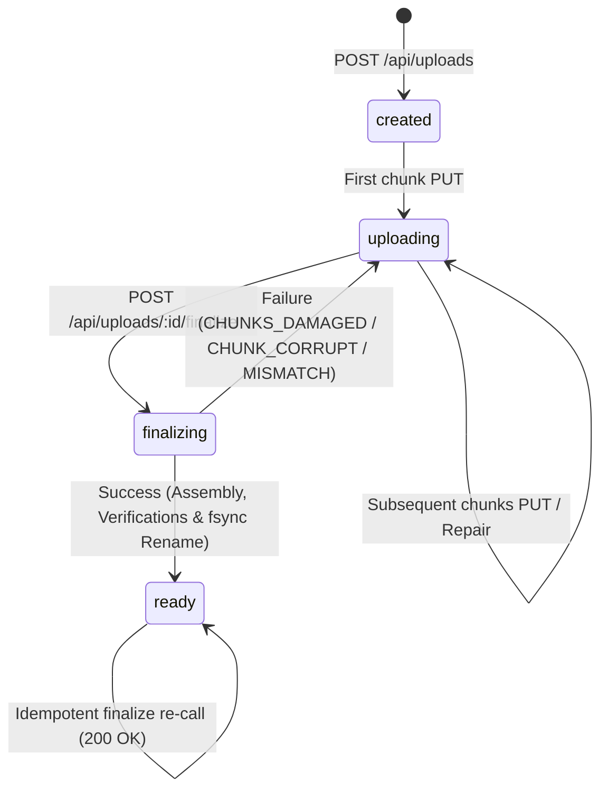

# Scalable File Upload & Streaming Media Service

A resilient, local-first media streaming service implemented in Node.js using **only core modules** (`http`, `fs`, `stream`, `crypto`, `path`, `url`, `os`, `node:test`, `node:assert`). No third-party npm dependencies.

The architecture is built around a **"Proof-of-Progress" Transfer Ledger**:
- Chunked, resumable file uploads with bounded application memory.
- Per-chunk SHA-256 verification and atomic metadata ledger updates.
- Idempotent retries and client resume map.
- Ordered chunk assembly and whole-file hash validation.
- HTTP Range streaming (`200 OK`, `206 Partial Content`, `416 Range Not Satisfiable`) for instant browser seeking without full-file buffering.

---

## Current Status: Checkpoint 6A (Metrics Backend & Client Concurrency)

- **HTTP Foundations & Router**: Parameterized router, error boundaries, request timing logger with client abort detection (`res.on('close')`, `!res.writableFinished`).
- **Durable Upload Metadata Store**: Atomic writes via temporary files, `fsync`, per-upload serialized update queue, and atomic JSON writer.
- **Strict Chunk Verification**: Content-Range mathematical validation, on-the-fly streaming SHA-256 verification, and exact byte counting.
- **Durable Chunk Ledger & Range Engine**: Integer byte math, adjacent and overlapping range merging, missing range calculation.
- **Idempotency & Concurrency Safety**: Fast-path duplicate recognition, in-lock chunk commit and race resolution, rollback on write failures.
- **Damaged-Chunk Repair**: In-lock atomic chunk replacement when committed chunk files are missing or truncated on disk.
- **Bounded-Memory Assembly Pipeline**: Single streaming pipeline using async generators, per-chunk SHA-256 verification, whole-file digest calculation, and atomic media publishing.
- **Media Catalog Service**: Atomic metadata catalog listing (`GET /api/media`) sorted newest first, with pagination, skipping corrupt/orphan records without directory creation on GET.
- **HTTP Range Streaming Engine**: RFC 9110 compliant single-range streaming (`200 OK`, `206 Partial Content`, `416 Range Not Satisfiable`), strict validator rules (`ETag` quoted strong match only, `Last-Modified`, `If-None-Match`, `If-Range`), sanitized `Content-Disposition`, pass-through byte counting Transform, and backpressured chunk streaming (64 KiB buffer).
- **Pure Math Metrics Helpers**: Integer math for activeMs (merging intervals with 1000ms gap tolerance), bytesPerSecond, toMiBps, median, rolling window recentThroughput, estimateEta, heuristic recommendChunkSize, and resendEfficiency.
- **Stateful Metrics Store**: Isolated per-server instance (no global singleton), LRU cap of 200 uploads, rolling process-wide 20-chunk window, debounced 500ms atomic persistence to `storage/uploads/<id>/metrics.json`, failure resilience (swallowed with ID logged), and non-durable in-memory media request counters.
- **Global & Per-Upload Metrics Endpoints**: `GET /api/metrics/:id`, `GET /api/recommendation/chunk-size`, and `GET /api/stats`.
- **Client Concurrency & Metrics**: Bounded worker pool (concurrency 1..8) with bounded memory streaming, one-shot `corruptChunkIndex` failure injection, and client-observed performance metrics (`clientMetrics`).

---

## State Machine & Ingestion Lifecycle



### State Definitions
1. **`created`**: Upload session registered in metadata. No chunks committed yet.
2. **`uploading`**: One or more chunks have been durably verified and committed to the ledger.
3. **`finalizing`**: Finalization has begun. Chunk PUTs are blocked (409 Conflict). If assembly or verification fails, the state automatically reverts to `uploading` with `lastFinalizeError` recorded in metadata.
4. **`ready`**: Whole-file assembly and SHA-256 verification succeeded. Media file and separate media JSON metadata published. Chunk directory contents cleaned up. Subsequent PUTs return 409 Conflict; subsequent finalize calls return 200 OK idempotently.

---

## Damaged-Chunk Repair Flow

If a committed chunk file is accidentally deleted or truncated on physical storage:
1. **Detection**: `GET /api/uploads/:id?verify=true` or `finalize` inspects disk files and detects the missing/truncated chunk (`CHUNKS_DAMAGED`).
2. **Ledger Cleansing**: In `finalize`, damaged chunks are pruned from the ledger so they report as missing. In `PUT /api/uploads/:id/chunks/:index`, the server checks whether the file on disk is intact.
3. **Atomic Repair**: If the file on disk is damaged, the server streams the incoming chunk, verifies its SHA-256, and inside the per-upload lock atomically replaces the damaged file with the verified temp file (`fs.promises.rename`).
4. **Response**: The server returns `201 Created` with `{ duplicate: false, repaired: true }`.

---

## API (Checkpoint 4)

### 1. Create Upload Session
Initializes an upload session and allocates metadata.

- **Route**: `POST /api/uploads`
- **Headers**: `Content-Type: application/json`
- **Body**:
  ```json
  {
    "filename": "sample-video.mp4",
    "size": 3670016,
    "contentType": "video/mp4",
    "chunkSize": 1048576
  }
  ```
- **Response** (`201 Created`):
  ```json
  {
    "uploadId": "3fa85f64-5717-4562-b3fc-2c963f66afa6",
    "chunkSize": 1048576,
    "totalChunks": 4,
    "expectedSize": 3670016,
    "state": "created"
  }
  ```

---

### 2. Upload or Repair Chunk
Streams raw binary bytes for one chunk. Validates range, length, and SHA-256 before committing to disk.

- **Route**: `PUT /api/uploads/:id/chunks/:index`
- **Headers**:
  - `Content-Range: bytes <start>-<end>/<total>` (e.g. `bytes 0-1048575/3670016`)
  - `X-Chunk-SHA256: <64-character-hex-digest>`
  - `Content-Length: <chunk-byte-length>`
- **Body**: Raw binary chunk bytes
- **Response**:
  - Fresh commit: `201 Created` with `{ duplicate: false, repaired: false }`
  - Idempotent duplicate: `200 OK` with `{ duplicate: true, repaired: false }`
  - Damaged chunk repaired: `201 Created` with `{ duplicate: false, repaired: true }`

---

### 3. Query Upload Status & Resume Map
Queries authoritative transfer progress and missing chunk ranges.

- **Route**: `GET /api/uploads/:id[?verify=true]`
- **Response** (`200 OK`):
  ```json
  {
    "uploadId": "3fa85f64-5717-4562-b3fc-2c963f66afa6",
    "originalName": "sample-video.mp4",
    "state": "uploading",
    "expectedSize": 3670016,
    "chunkSize": 1048576,
    "totalChunks": 4,
    "createdAt": "2026-11-07T14:00:00.000Z",
    "committedChunks": [0, 1, 2],
    "missingChunks": [3],
    "committedRanges": [{"start": 0, "end": 3145727}],
    "missingRanges": [{"start": 3145728, "end": 3670015}],
    "committedBytes": 3145728,
    "progressPercent": 85.71,
    "verified": false
  }
  ```

---

### 4. Finalize Upload & Publish Media
Validates full ledger coverage, streams and verifies all chunks, computes whole-file digest, and publishes media.

- **Route**: `POST /api/uploads/:id/finalize`
- **Headers**: `Content-Type: application/json` (optional)
- **Body** (optional):
  ```json
  {
    "sha256": "168b47cc3db6e3382735a0921ebb33ffd8bd4b0dd6a43b6c138b3530dad928c5"
  }
  ```
- **Response** (`200 OK`):
  ```json
  {
    "mediaId": "4a737385-e192-482f-89a1-cb9da0f7926b",
    "uploadId": "3fa85f64-5717-4562-b3fc-2c963f66afa6",
    "originalName": "sample-video.mp4",
    "contentType": "video/mp4",
    "size": 3670016,
    "sha256": "168b47cc3db6e3382735a0921ebb33ffd8bd4b0dd6a43b6c138b3530dad928c5",
    "createdAt": "2026-11-07T14:05:00.000Z",
    "state": "ready",
    "downloadUrl": "/api/media/4a737385-e192-482f-89a1-cb9da0f7926b",
    "stats": {
      "chunks": 4,
      "assemblyMs": 14,
      "verifiedChunks": 4
    }
  }
  ```

---

### Finalization Error Codes

| Status | Code | Meaning & Action |
| :--- | :--- | :--- |
| **409** | `INCOMPLETE_UPLOAD` | Upload has missing chunks. Details contain `missingChunks` and `missingRanges`. Session remains in `uploading`. |
| **409** | `LEDGER_INVALID` | Ledger contains duplicate chunk indices, overlapping ranges, or size sum mismatch. Details contain `problems`. |
| **409** | `FINALIZE_IN_PROGRESS` | Another finalize worker in the same process is actively assembling this upload. |
| **409** | `CHUNKS_DAMAGED` | One or more chunk files were deleted or truncated on disk. Damaged records are pruned from ledger; client can resume and re-send those chunks. |
| **422** | `CHUNK_CORRUPT` | Chunk content failed SHA-256 verification during assembly. Chunk is pruned from ledger; client can resume and re-send. |
| **422** | `FILE_CHECKSUM_MISMATCH` | Computed whole-file SHA-256 does not match client-supplied `sha256`. Upload state returns to `uploading`. |

---

## Client Usage (`simulate-interruption.js`)

The test client provides upload, interruption simulation, resumption, and finalization:

```bash
# 1. Upload with interruption after 3 chunks
node scripts/simulate-interruption.js upload /tmp/sample.mp4 --chunk 1048576 --stop-after 3

# 2. Resume missing chunks and automatically finalize
node scripts/simulate-interruption.js resume /tmp/sample.mp4 --id <uploadId> --finalize

# 3. Finalize an already complete upload directly
node scripts/simulate-interruption.js finalize /tmp/sample.mp4 --id <uploadId>
```

---

## Known Limitations (Checkpoint 4)

1. **Assembly Storage Overhead**: File assembly writes the unified file while individual chunk files still exist, temporarily requiring up to 2x file size on disk before chunk files are pruned.
2. **In-Process Finalization Concurrency Lock**: Active finalization serialization uses an in-process memory set (`activeFinalizations`). Multi-process scaling will transition to distributed locking in later checkpoints.
3. **Orphan Media Recovery**: If an unhandled OS kill occurs precisely between media rename and metadata update, an unlinked media file could remain in `storage/media/`. Background garbage collection is scheduled for the hardening checkpoint.

---

## Requirements

- **Node.js**: v20.x LTS or higher (tested on Node.js v20.20.2)
- **Dependencies**: None (0 external npm dependencies)

---

## Quick Start

### 1. Run the Development Server
```bash
cd file-stream-service
npm run dev
```
Or start in production mode:
```bash
npm start
```
By default, the server binds to `http://127.0.0.1:3000`.

### 2. Run Automated Tests
```bash
npm test
```
Runs the full test suite using Node's native test runner (`node:test`).

### 3. Generate Test Files
Generate deterministic test files of any size without loading the whole file into RAM:
```bash
node scripts/generate-test-file.js 3.5MiB /tmp/test-file.bin
```

---

## API (Checkpoint 2)

### 1. Create Upload Session
Initializes an upload session and allocates metadata.

- **Route**: `POST /api/uploads`
- **Headers**: `Content-Type: application/json`
- **Body**:
  ```json
  {
    "filename": "sample-video.mp4",
    "size": 3670016,
    "contentType": "video/mp4",
    "chunkSize": 1048576
  }
  ```
- **Response** (`201 Created`):
  ```json
  {
    "uploadId": "3fa85f64-5717-4562-b3fc-2c963f66afa6",
    "chunkSize": 1048576,
    "totalChunks": 4,
    "expectedSize": 3670016,
    "state": "created"
  }
  ```
- **Example curl**:
  ```bash
  curl -i -X POST http://localhost:3000/api/uploads \
    -H "Content-Type: application/json" \
    -d '{"filename":"sample.mp4","size":3670016,"contentType":"video/mp4","chunkSize":1048576}'
  ```

---

### 2. Upload Chunk
Streams raw binary bytes for one chunk. Validates range, length, and SHA-256 before committing to disk.

- **Route**: `PUT /api/uploads/:id/chunks/:index`
- **Headers**:
  - `Content-Range: bytes <start>-<end>/<total>` (e.g. `bytes 0-1048575/3670016`)
  - `X-Chunk-SHA256: <64-character-hex-digest>`
  - `Content-Length: <chunk-byte-length>`
- **Body**: Raw binary chunk bytes
- **Response** (`201 Created`):
  ```json
  {
    "index": 0,
    "start": 0,
    "end": 1048575,
    "size": 1048576,
    "checksum": "e3b0c44298fc1c149afbf4c8996fb92427ae41e4649b934ca495991b7852b855",
    "committedAt": "2026-11-07T14:00:00.000Z"
  }
  ```
- **Example curl**:
  ```bash
  curl -i -X PUT http://localhost:3000/api/uploads/3fa85f64-5717-4562-b3fc-2c963f66afa6/chunks/0 \
    -H "Content-Range: bytes 0-1048575/3670016" \
    -H "X-Chunk-SHA256: <computed_sha256>" \
    -H "Content-Length: 1048576" \
    --data-binary "@/tmp/chunk_0.part"
  ```

---

### Status Codes (Checkpoint 2)

| Status | Code | Meaning |
| :--- | :--- | :--- |
| **201** | `CREATED` | Upload session created or chunk committed and verified. |
| **400** | `BAD_REQUEST` | Malformed JSON body, missing/invalid Content-Range or Content-Length, out-of-range index. |
| **404** | `NOT_FOUND` | Unknown route, malformed upload ID format, or non-existent upload session. |
| **409** | `CONFLICT` | Chunk index already committed, or concurrency limit (`maxConcurrentUploads`) reached. |
| **413** | `PAYLOAD_TOO_LARGE` | JSON body exceeds `maxJsonBodyBytes`, chunk length exceeds `maxChunkBytes`, or file size exceeds `maxUploadBytes`. Includes `Connection: close`. |
| **415** | `UNSUPPORTED_MEDIA_TYPE` | Non-JSON body sent to JSON endpoints, or `contentType` not in `allowedContentTypes`. |
| **422** | `UNPROCESSABLE_ENTITY` | Content-Range range mismatch for index, total size mismatch, Content-Length mismatch, or `CHECKSUM_MISMATCH`. |

---

## API (Checkpoint 5: Media Catalog & HTTP Range Streaming)

### 1. List Published Media
Retrieves all published media records from the durable catalog, sorted newest first (`createdAt` DESC).

- **Route**: `GET /api/media`
- **Query Parameters**:
  - `limit` (optional): Number of records to return (1 - 500, default: 100).
- **Response** (`200 OK`):
  ```json
  {
    "items": [
      {
        "mediaId": "4bf0800d-f2eb-45b0-8c29-c87fa281fa04",
        "name": "sample-video.mp4",
        "size": 6815744,
        "contentType": "video/mp4",
        "sha256": "4b6118d360ef82c2195f13ef454c79bc0dbadceb7095989e246944e4a053cbfd",
        "createdAt": "2026-11-07T16:00:00.000Z",
        "url": "/api/media/4bf0800d-f2eb-45b0-8c29-c87fa281fa04"
      }
    ],
    "count": 1
  }
  ```

---

### 2. Stream Media Content & HTTP Range
Streams published media files with support for full representation (`200 OK`), byte range slices (`206 Partial Content`), condition checking (`304 Not Modified`), and metadata-only inspection (`HEAD`).

- **Route**: `GET /api/media/:id` or `HEAD /api/media/:id`
- **Headers**:
  - `Range`: (Optional) `bytes=<start>-<end>`, `bytes=<start>-`, or `bytes=-<suffix>`
  - `If-None-Match`: (Optional) `"<sha256>"` or `*`
  - `If-Range`: (Optional) `"<sha256>"` or HTTP-date
- **Query Parameters**:
  - `download=1`: (Optional) Forces `Content-Disposition: attachment`
- **Response Headers**:
  - `Content-Type`: Stored media MIME type (e.g. `video/mp4`)
  - `Accept-Ranges`: `bytes`
  - `ETag`: `"<sha256>"` (strong, quoted whole-file digest)
  - `Last-Modified`: HTTP-date format
  - `Cache-Control`: `no-cache`
  - `X-Content-Type-Options`: `nosniff`
  - `Content-Disposition`: `inline` (or `attachment` for octet-stream / `?download=1`) with ASCII fallback `filename="..."` and RFC 5987 `filename*=UTF-8''...`

---

### Range Behavior Matrix

| Range Kind | Request Example | Status Code | Content-Range | Body Content |
| :--- | :--- | :--- | :--- | :--- |
| **`none`** | *(No Range header)* | `200 OK` | None | Full resource stream |
| **`multi`** | `Range: bytes=0-10,20-30` | `200 OK` | None | Full resource stream (deliberate choice) |
| **`range`** | `Range: bytes=0-1023` | `206 Partial Content` | `bytes 0-1023/S` | Requested inclusive byte slice |
| **`unsatisfiable`** | `Range: bytes=S-` | `416 Range Not Satisfiable` | `bytes */S` | JSON error body |
| **`malformed`** | `Range: bytes=abc` or `5-4` | `400 Bad Request` | None | JSON error body |

---

### Conditional Request Evaluation Order

1. **`If-None-Match`**:
   Evaluated first using weak comparison against the resource's strong ETag (`"<sha256>"`). If the client tag matches or is `*`, the server immediately responds with `304 Not Modified` and zero body bytes.
2. **`If-Range` & `Range`**:
   If a `Range` header is present:
   - If no `If-Range` header was supplied, evaluate `Range`.
   - If `If-Range` is supplied and matches the ETag exactly OR matches the `Last-Modified` date string exactly, evaluate `Range` (`206 Partial Content`).
   - If `If-Range` does NOT match, the client has a stale representation: ignore the `Range` header and serve the full resource (`200 OK`).

---

### Architectural & Design Notes

1. **Why HTTP byte ranges are inclusive (contrast with `Blob.prototype.slice`)**:
   RFC 9110 §14.1.2 defines byte ranges as closed intervals `[start, end]`. A range `bytes=0-1023` transmits 1,024 bytes (bytes 0 through 1023 inclusive). In contrast, JavaScript `Blob.prototype.slice(start, end)` uses half-open intervals `[start, end)` where `end` is exclusive.
2. **Why 416 responses MUST carry `Content-Range: bytes */S`**:
   Per RFC 9110 §14.4, when a byte range is rejected with `416 Range Not Satisfiable`, the response must include a `Content-Range` header with the current complete representation size `S`. This informs media players and download managers of the valid file length so they can adjust and reissue valid byte ranges without querying `HEAD`.
3. **Why malformed and unsatisfiable ranges never degrade to full 200**:
   Silently falling back to `200 OK` on invalid ranges would cause a video player seeking near the end of a 2 GiB video to inadvertently trigger a multi-gigabyte transfer, stalling playback and consuming unnecessary bandwidth.
4. **Why multi-range is deliberately served as 200**:
   Multi-range requests (`bytes=0-1,5-6`) require `multipart/byteranges` MIME multipart framing. Modern HTML5 `<video>` and `<audio>` players exclusively issue single contiguous byte ranges during seeking. RFC 9110 §14.2 permits servers that do not support multipart ranges to ignore `Range` and return `200 OK` full representation.
5. **HTML5 `<video>` Seeking Behavior**:
   Browsers seek HTML5 `<video>` and `<audio>` elements by issuing byte Range requests (`bytes=start-end`) expecting `206 Partial Content`. The browser uses `Content-Range` to index keyframes and scrub smoothly through the media stream without downloading the entire media file.
6. **Deferred Headers & Stream Backpressure**:
   The streaming pipeline uses 64 KiB chunks with native stream backpressure (`pipeline(readStream, res)`). Calling `res.writeHead()` only after the read stream emits `'open'` ensures that any open-time I/O error cleanly routes to `sendError` without crashing the response.

---

### Example curl Invocations

```bash
# 1. Inspect media headers without body
curl -I http://localhost:3000/api/media/4bf0800d-f2eb-45b0-8c29-c87fa281fa04

# 2. Download specific byte range (first 1024 bytes)
curl -i -H "Range: bytes=0-1023" http://localhost:3000/api/media/4bf0800d-f2eb-45b0-8c29-c87fa281fa04 -o /tmp/range.bin

# 3. Suffix byte range (last 500 bytes)
curl -i -H "Range: bytes=-500" http://localhost:3000/api/media/4bf0800d-f2eb-45b0-8c29-c87fa281fa04 -o /tmp/suffix.bin

# 4. Open-ended byte range
curl -i -H "Range: bytes=6815000-" http://localhost:3000/api/media/4bf0800d-f2eb-45b0-8c29-c87fa281fa04 -o /tmp/tail.bin

# 5. Unsatisfiable range (returns 416 with Content-Range: bytes */size)
curl -i -H "Range: bytes=6815744-" http://localhost:3000/api/media/4bf0800d-f2eb-45b0-8c29-c87fa281fa04

# 6. Conditional If-Range (mismatched ETag falls back to 200 full download)
curl -i -H "Range: bytes=0-1023" \
  -H 'If-Range: "0000000000000000000000000000000000000000000000000000000000000000"' \
  http://localhost:3000/api/media/4bf0800d-f2eb-45b0-8c29-c87fa281fa04
```

---

## Configuration & Environment Variables

| Variable | Default | Description |
| :--- | :--- | :--- |
| `HOST` | `127.0.0.1` | Network interface to bind to |
| `PORT` | `3000` | Port to listen on (1 - 65535) |
| `STORAGE_ROOT` | `<repoRoot>/storage` | Directory where uploads, temp chunks, and media are kept (resolved relative to `config.js`; `STORAGE_ROOT` env override is resolved relative to `process.cwd()`) |
| `MAX_JSON_BODY_BYTES` | `65536` (64 KiB) | Strict upper bound for JSON request bodies |
| `MAX_UPLOAD_BYTES` | `2147483648` (2 GiB) | Maximum total file size allowed for uploads |
| `MIN_CHUNK_BYTES` | `65536` (64 KiB) | Minimum chunk size allowed |
| `DEFAULT_CHUNK_BYTES` | `1048576` (1 MiB) | Default chunk size recommended to clients |
| `MAX_CHUNK_BYTES` | `16777216` (16 MiB) | Maximum chunk size allowed |
| `MAX_CONCURRENT_UPLOADS` | `10` | Maximum parallel upload sessions |
| `MAX_FILENAME_LENGTH` | `255` | Filename length limit |
| `REQUEST_TIMEOUT_MS` | `120000` (120s) | Server request timeout |
| `HEADERS_TIMEOUT_MS` | `60000` (60s) | Server headers timeout (must be <= request timeout) |
| `KEEP_ALIVE_TIMEOUT_MS` | `5000` (5s) | HTTP keep-alive timeout |

---

---

## Metrics & Observability (Checkpoint 6A)

### API Endpoints

#### 1. Upload Metrics: `GET /api/metrics/:uploadId`
Returns detailed performance metrics and transfer statistics for a given upload session.
- **Status Codes**: `200 OK`, `400 Bad Request` (invalid id format), `404 Not Found` (unknown upload).
- **Response Format**:
```json
{
  "uploadId": "4bf0800d-f2eb-45b0-8c29-c87fa281fa04",
  "state": "ready",
  "totalBytes": 13107200,
  "committedBytes": 13107200,
  "progressPct": 100,
  "time": {
    "startedAt": "2026-11-07T10:00:00.000Z",
    "updatedAt": "2026-11-07T10:00:05.000Z",
    "wallClockMs": 5000,
    "activeMs": 3500
  },
  "throughput": {
    "effective": { "bytesPerSecond": 3744914, "mibPerSecond": 3.57 },
    "network": { "bytesPerSecond": 3744914, "mibPerSecond": 3.57 },
    "windowed": { "bytesPerSecond": 3800000, "mibPerSecond": 3.62 }
  },
  "etaMs": 0,
  "chunks": {
    "total": 13,
    "committed": 13,
    "receivedAttempts": 13,
    "duplicates": 0,
    "repaired": 0,
    "checksumMismatches": 0,
    "conflicts": 0,
    "aborted": 0,
    "resendEfficiency": 1
  },
  "recommendations": {
    "chunkSize": 2097152,
    "reason": "nominal"
  },
  "media": {
    "mediaId": "4bf0800d-f2eb-45b0-8c29-c87fa281fa04",
    "totalRequests": 3,
    "bytesServed": 10240,
    "rangeRequests": 2,
    "fullRequests": 1,
    "abortedRequests": 0
  }
}
```

#### Metrics Definitions

| Metric | Definition |
| :--- | :--- |
| `activeMs` | Total non-overlapping active transfer time across all chunk requests (merged intervals). Unlike `wallClockMs`, it excludes client idle/pause periods and does not double-count overlapping parallel chunks. |
| `wallClockMs` | Total elapsed duration from first chunk receipt to last update (`updatedAt - startedAt`). |
| `effectiveThroughput` | Useful bytes committed to disk divided by `activeMs` (`committedBytes / (activeMs / 1000)`). Reflects true upload progress. |
| `networkThroughput` | Total raw chunk bytes received over the wire (including duplicates and discarded retries) divided by `activeMs`. |
| `windowedThroughput` | Median throughput of the last 20 completed chunk attempts. Stable against cold-start variance. |
| `resendEfficiency` | Ratio of committed chunks to total received chunk attempts (`committed / receivedAttempts`). Values < 1.0 indicate redundant retries or transmission errors. |

#### 2. Global Chunk Size Recommendation: `GET /api/recommendation/chunk-size`
Returns dynamic chunk sizing advice based on recent global transfer conditions:
```json
{
  "recommendedChunkSize": 2097152,
  "reason": "nominal",
  "minChunkBytes": 65536,
  "maxChunkBytes": 16777216,
  "sampleCount": 20
}
```

#### 3. Server System Stats: `GET /api/stats`
Returns process-level uptime, memory metrics, and count of active tracked uploads:
```json
{
  "uptimeSeconds": 142.5,
  "memory": {
    "rssBytes": 38404096,
    "heapTotalBytes": 18219008,
    "heapUsedBytes": 12450320,
    "externalBytes": 1920384
  },
  "trackedUploads": 4
}
```

---

## Client Simulation Tool (`scripts/simulate-interruption.js`)

The test client simulates robust parallel chunk uploads, pause/resume behavior, and failure modes.

### CLI Flags
- `--concurrency N`: Number of parallel chunk workers (1 to 8, default: 1).
- `--chunk-size BYTES`: Chunk size in bytes (defaults to server recommendation).
- `--stop-after K`: Concurrency-safe limit; stops after starting `K` chunk uploads.
- `--corrupt-chunk INDEX`: Corrupts the payload of the specified chunk index to simulate network bit-rot / integrity check rejection.
- `--finalize`: Automatically calls the finalization endpoint once all chunks are uploaded.

### Example Commands
```bash
# Upload first 5 chunks using 3 concurrent workers
node scripts/simulate-interruption.js upload /tmp/test-12m.bin --concurrency 3 --stop-after 5

# Resume upload session
node scripts/simulate-interruption.js resume /tmp/test-12m.bin --id <uploadId> --concurrency 3 --finalize

# Inject chunk corruption into chunk 2
node scripts/simulate-interruption.js upload /tmp/test-12m.bin --corrupt-chunk 2
```

---

## Web UI (Checkpoint 6B)

A vanilla, zero-dependency browser interface is served directly by the server to provide real-time visibility into the upload lifecycle, transfer ledger, performance metrics, and media playback.

### Accessing the Web UI
Open your browser to:
```
http://127.0.0.1:3000/
```

> **Security Context Requirement (`crypto.subtle`)**:
> The browser UI utilizes the W3C Web Cryptography API (`crypto.subtle.digest`) to compute SHA-256 chunk hashes locally before transmission. In accordance with web platform security standards, `crypto.subtle` is **only available in Secure Contexts** (`https://` or `http://localhost` / `http://127.0.0.1`). Connecting over plain-HTTP across external LAN IP addresses (e.g., `http://192.168.1.50:3000`) will disable Web Crypto; always use `127.0.0.1` or `localhost`.

### Content Security Policy (CSP)
The static file server enforces a strict CSP header on HTML responses:
```http
Content-Security-Policy: default-src 'self'; script-src 'self'; style-src 'self'; img-src 'self' data: blob:; media-src 'self'; connect-src 'self'; object-src 'none'; base-uri 'none'; form-action 'none'; frame-ancestors 'none'
```
- No inline scripts (`<script>...`) or styles (`style="..."`) are permitted.
- No third-party domains, CDNs, or external fonts are loaded.
- All dynamic UI elements are populated using `document.createElement` and `textContent` (never `innerHTML` or `eval`).

### UI Panels Overview
1. **Upload Configuration Panel**: File selection (file picker & drag-and-drop zone), content-type selection constrained to server allow-list (defaults to `video/mp4`), chunk size selection (256 KiB, 1 MiB, 4 MiB, or dynamic heuristic recommendation), concurrency slider (1–4 workers), and control buttons (**Start Upload**, **Interrupt**, **Resume**, **Finalize**).
2. **Failure Injection ("Demo Tools")**: Configurable parameters for testing resilience:
   - *Stop after N chunks*: Automatically halts workers after N chunks to demonstrate interrupted transfers.
   - *Corrupt checksum of chunk I*: Injects an invalid SHA-256 checksum on chunk I to demonstrate server-side `422 Unprocessable Entity` rejection and zero redundant retransmissions upon resume.
3. **Ingestion Lifecycle Pills**: Real-time status indicator tracking `created` → `uploading` → `finalizing` → `ready`.
4. **Proof-of-Progress Ledger Grid**:
   - Visual chunk grid using bounded bucketing (at most 256 cells) to prevent DOM bloat on multi-gigabyte files.
   - Multi-modal state differentiation: distinct borders, background patterns, and Unicode glyphs (`✔` committed, `⏳` in flight, `✖` failed, `🔧` repaired, `◐` partial, `·` missing) ensure accessibility without relying solely on color.
   - Authoritative text range display: committed byte ranges and missing byte ranges as reported by the server ledger.
   - Durable progress bar reflecting strictly server-committed bytes (`committedBytes / expectedSize`).
5. **Real-Time Telemetry & Performance Metrics**:
   - Server-observed throughput (MiB/s) and client-observed throughput (including client hashing overhead).
   - Dynamic ETA calculation (displayed only when sufficient chunk data exists).
   - Resend efficiency percentage, retry count, duplicate count, and repair count.
   - Non-overlapping `activeMs` vs monotonic `wallMs`.
   - Per-chunk verified digest ledger and final whole-file SHA-256.
6. **Resume Session Persistence**: File fingerprinting (`name + size + lastModified`) stored in browser `localStorage` (safely isolated with try/catch). Re-selecting an interrupted file detects existing sessions and queries the server for uncommitted chunks. If the session expired (`session_gone`), the user is prompted to start a clean upload.
7. **Media Player & Catalog**: Automatic media listing (`GET /api/media`). Selecting an assembled video mounts a native `<video controls>` element with direct streaming from `/api/media/<id>` and an explicit download link (`?download=1`).
8. **Interactive HTTP Range Probe**: Educational widget demonstrating RFC 9110 byte-range slicing without full downloads. Preset buttons (*First 1 KiB*, *Middle 1 KiB*, *Last 500 bytes*, *Past EOF 416*, *Malformed 400*, and Custom Range) issue range requests, inspect response headers (`Content-Range`, `Content-Length`, `ETag`), and abort connection bodies immediately to avoid unnecessary buffering.
9. **Accessible Error Banner**: Prominent, dismissible error notifications displaying server error codes and sanitized status messages via `textContent`.

### Memory Bounds & Whole-File Hash Design
- **Why the browser skips whole-file hashing**: The W3C `crypto.subtle.digest()` API lacks streaming or incremental chunk updates; computing a whole-file SHA-256 in the browser requires loading the entire file into a contiguous memory `ArrayBuffer`, which crashes the browser tab with Out-Of-Memory (OOM) errors on large media files. Instead, the browser verifies small 1 MiB chunk slices in memory, while the server calculates and verifies the whole-file digest during disk assembly.
- **Client Memory Cap**: At any given moment, client memory is bounded to at most `concurrency × chunkSize` (e.g. 4 × 16 MiB = 64 MiB maximum).

---

## Cleanup Policy (Checkpoint 7A)

The service includes an automated background cleanup worker and standalone CLI (`node scripts/cleanup.js`) to reclaim disk space from abandoned uploads and temporary transfer files while preserving ledger audit history.

### TTL Configuration Settings
| Config Option | Environment Variable | Default | Purpose |
| :--- | :--- | :--- | :--- |
| `sessionTtlMs` | `SESSION_TTL_MS` | `86400000` (24 h) | Inactivity expiration timeout for `created` and `uploading` sessions, measured from newest of `createdAt`, last chunk `committedAt`, or `finalizeStartedAt`. |
| `tempFileTtlMs` | `TEMP_FILE_TTL_MS` | `3600000` (1 h) | Age threshold for unlinking orphaned files in `storage/temp`, excluding active assembly files. |
| `orphanGraceMs` | `ORPHAN_GRACE_MS` | `3600000` (1 h) | Safety grace window protecting unreferenced chunk or media files from race conditions during active writes. |
| `cleanupIntervalMs` | `CLEANUP_INTERVAL_MS` | `600000` (10 min) | Periodic timer interval for server-managed background cleanup sweeps. |

### Session Expiration Protocol (`SESSION_EXPIRED`)
- When an upload session exceeds `sessionTtlMs` without activity, the cleanup worker transitions its state to `"expired"` (`expiredAt` timestamp recorded).
- Underlying chunk files (`storage/uploads/<id>/chunks/*`) and temporary part files are unlinked to free physical storage.
- Authoritative session metadata (`metadata.json`) and telemetry (`metrics.json`) are permanently preserved for accounting and diagnostics.
- Any subsequent `PUT` chunk request or `POST` finalize request on an expired session is rejected with HTTP `409 Conflict` and error code `SESSION_EXPIRED`:
  ```json
  {
    "error": {
      "code": "SESSION_EXPIRED",
      "message": "Upload session \"<id>\" has expired",
      "details": null
    }
  }
  ```
- The status query `GET /api/uploads/<id>` remains accessible, returning HTTP `200 OK` with `"state": "expired"`.

---

## Known Limitations & Design Decisions

- **Process-Local Metrics State**: The metrics store maintains an in-memory LRU cache (capped at 200 sessions) and a rolling window of recent chunk transfers. Periodic debounced writes persist state to `storage/uploads/<id>/metrics.json`. In a multi-process cluster, disk metrics are shared after persistence, but in-memory rolling windows and active interval mergers are isolated to each worker process.
- **Integer Math**: All byte totals, durations, and rate limits use strict integer rounding (`Math.floor` / `Math.ceil`) to prevent floating-point drift across platforms.
- **Failure Isolation**: Any failure in the metrics recording layer is logged and safely swallowed to guarantee that upload and media streaming operations are never failed or slowed by telemetry.

---

## Roadmap

- **Checkpoint 6B**: Minimal Proof-of-Progress Browser UI & Static File Serving.
- **Checkpoint 7**: Hardening, Edge Case Fuzzing & High-Concurrency Benchmarks.
